# Tutorial — Loyalty Wallet passo passo

Guida all'uso di tutta l'applicazione, dal cliente che si iscrive al bancone fino all'assistenza interna. Ogni
immagine è uno **screenshot reale** dell'app in esecuzione in locale, scattato da uno script che la usa come farebbe
una persona (`apps/merchant/scripts/tutorial-screenshots.mjs`, vedi [in fondo](#come-rigenerare-gli-screenshot)).

| Chi                    | Cosa usa                                              | Capitolo                                                  |
| ---------------------- | ----------------------------------------------------- | --------------------------------------------------------- |
| Cliente del negozio    | pagina web di iscrizione + carta nel Wallet, niente app | [1. Il cliente si iscrive](#1-il-cliente-si-iscrive)      |
| Operatore (in cassa)   | app esercente: Scanner e Profilo                      | [2. Accesso](#2-accesso-allapp-esercente), [3. In cassa](#3-in-cassa-timbri-e-premi) |
| Titolare               | app esercente: tutte le sezioni                       | [4. Area titolare](#4-area-titolare) e seguenti          |
| Team Loyalty Wallet    | pannello interno `/interno`                           | [7. Pannello interno](#7-pannello-interno-assistenza)     |

I dati sono quelli di prova del negozio **Salone Demo** (carta a timbri, 10 tagli = 1 gratis, almeno 60 minuti tra
due timbri) e del **Bar Punti Demo** (carta a punti con livelli). I clienti dei capitoli 3–6 sono inventati e
vengono creati dallo script.

> **Cosa non si vede qui.** La carta dentro l'app Google Wallet del telefono (lo script non può fotografarla:
> il pulsante "Aggiungi a Google Wallet" porta all'app di Google) e Apple Wallet, che arriva con la Fase 12.
> Le email reali eventualmente presenti nel database locale sono sfocate.

---

## 1. Il cliente si iscrive

Il cliente non scarica nessuna app e non ha un account: inquadra un QR, scrive nome e telefono, conferma con un
codice SMS e salva la carta nel Wallet.

### 1.1 Il cartello al bancone

Il titolare stampa il cartello A5 (dall'app, sezione **Cartello**, o da `/<negozio>/qr`). Il QR porta alla pagina di
iscrizione del negozio; la griglia ripete la regola della carta.


### 1.2 La pagina di iscrizione

Inquadrato il QR si apre la pagina con i colori del negozio: la regola ("Ogni 10 tagli, uno è gratis."), la carta
vuota e il modulo. Se il negozio vende tessere prepagate o abbonamenti, sotto la griglia ci sono anche i loro link.


Il consenso all'informativa è obbligatorio, quello alle offerte facoltativo. Premendo **Crea la mia carta** senza
compilare, un riepilogo in alto dice quanti campi sistemare e ogni campo spiega cosa manca:


### 1.3 Il codice SMS

Arriva un SMS con 6 cifre; il codice si verifica da solo alla sesta cifra (si può anche incollare). Dopo un minuto si
può chiedere un nuovo codice; **Cambia numero** torna al modulo. Con un codice sbagliato la pagina dice quanti
tentativi restano: dopo 5 errori il numero si blocca per 15 minuti.


### 1.4 La carta è pronta

Cosa succede dopo dipende dal dispositivo:

- **Android**: pulsante **Aggiungi a Google Wallet**. La carta si aggiorna da sola a ogni timbro.
- **iPhone**: finché non arriva Apple Wallet, la pagina mostra il QR e il codice breve di 8 caratteri da far vedere in
  cassa (conviene uno screenshot).
- **Computer**: un QR da inquadrare col telefono per salvare la carta lì; c'è comunque anche il pulsante di Google.


### 1.5 Cliente che si iscrive di nuovo

Chi si iscrive di nuovo con lo stesso numero (telefono nuovo, carta cancellata dal Wallet…) ritrova la **stessa
carta** con i timbri che aveva:


### 1.6 Negozio a punti

In un negozio a punti la frase spiega la regola ("1 punto per ogni euro: da 100 punti sei Gold.") e la carta mostra
saldo e livello invece della griglia.


### 1.7 Tessere prepagate e abbonamenti

Ogni tessera ha la sua pagina (`/<negozio>/t/<codice>`, con il suo cartello). Il cliente la crea qui, poi la paga in
cassa, dove viene attivata ([capitolo 5](#5-tessere-prepagate-e-abbonamenti)).


### 1.8 Privacy e promozioni

L'informativa è raggiungibile dal modulo (le parti segnate "[… da completare]" sono i dati del fornitore ancora da
inserire). Ogni promozione ricevuta ha un link per non riceverne più: un tocco e la carta resta attiva con tutti i
timbri.


Se l'abbonamento del negozio è sospeso, le iscrizioni si fermano con un messaggio chiaro (chi ha già la carta la
ritrova appena il servizio riprende):


---

## 2. Accesso all'app esercente

L'app esercente è una sola per iPhone, Android e browser. Si entra con l'email con cui il titolare ha invitato la
persona; l'accesso resta attivo sul dispositivo finché non si esce. **Password dimenticata?** manda un link per
sceglierne una nuova.


Chi lavora in più negozi sceglie dove si trova oggi; la scelta viene ricordata e si cambia dal Profilo.


---

## 3. In cassa: timbri e premi

L'operatore vede solo **Scanner** e **Profilo**. Il titolare ha le stesse schermate (voce **Scanner** del menu).

### 3.1 Leggere la carta

Tre modi, ricordati sul dispositivo:

- **Fotocamera**: si inquadra il QR della carta (nel Wallet o lo screenshot dell'iPhone).
- **Lettore**: un lettore QR USB o Bluetooth "scrive" il codice; il campo resta sempre pronto, anche per il cliente
  successivo, senza toccare nulla.
- **Codice**: si scrive a mano il codice breve di 8 caratteri sotto il QR.


Con la fotocamera la scheda si apre da sola appena il QR è leggibile:


### 3.2 La scheda del cliente e il timbro

Letta la carta si apre la scheda: nome, da quando è cliente, visite e timbri. **+1 timbro** aggiunge il timbro (la
carta nel Wallet si aggiorna da sola); per 5 minuti resta il pulsante **Annulla ultimo timbro** per gli errori.


Se il cliente ha già avuto un timbro da poco (qui il negozio chiede 60 minuti), l'app lo dice e propone **Ok, niente
timbro**. **Aggiungi comunque** lo dà lo stesso, ma resta nel registro.


### 3.3 Premio sbloccato e riscatto

Al decimo timbro la carta si completa: **Riscatta ora** oppure **Alla prossima visita** (il premio resta sulla
carta). Il riscatto chiede una conferma.


### 3.4 Quando qualcosa non va

- La carta è di un altro negozio (o il QR non è una carta): avviso chiaro, nessuna scheda aperta.
- Senza rete: banner in alto e pulsanti disattivati, così nessun timbro va perso o dato due volte.


### 3.5 Profilo e "Invia diagnostica"

Il Profilo mostra chi è collegato, il negozio, il ruolo e la versione dell'app. Se qualcosa non funziona, **Invia
diagnostica all'assistenza** manda gli ultimi eventi dell'app (nessun dato dei clienti) e restituisce un codice
ticket `DIAG-…` da comunicare all'assistenza.


---

## 4. Area titolare

Su computer le sezioni sono nella barra laterale; sul telefono in basso, con **Scansiona** sempre in alto.

### 4.1 Panoramica

I numeri della settimana (clienti iscritti, timbri, premi sbloccati, clienti inattivi), il grafico delle ultime 8
settimane e chi non torna da più di 60 giorni. Da qui si scarica anche il cartello.


### 4.2 Clienti

Ricerca per nome, telefono o codice della carta, con i filtri **Tutti**, **Con premio** e **Inattivi**. Il telefono è
sempre mascherato. Scelto un cliente si vedono saldo, consenso alle promozioni e storico.


**Correggi saldo** cambia timbri e premi con un motivo obbligatorio (timbro dimenticato, errore dello staff, carta di
carta vecchia, altro), che resta nello storico:


**Revoca consenso** toglie il cliente dalle promozioni (dall'app si può solo revocare: lo riattiva il cliente
iscrivendosi di nuovo). **Cancella cliente** elimina i dati dopo una doppia conferma con il codice della carta.


### 4.3 Carta

Carta attiva o spenta, timbri **oppure** punti, logo, colore, numero di timbri e premio, con l'anteprima di Google
Wallet e Apple Wallet (carta nuova, a metà, con premio). Al salvataggio le carte nei wallet si aggiornano entro
qualche minuto.


### 4.4 Staff

Invito con email, nome e ruolo: l'**operatore** dà timbri e riscatta premi, il **titolare** vede anche clienti,
statistiche e impostazioni. Per ogni persona: reinvio dell'invito, cambio di ruolo, rimozione.


### 4.5 Messaggi

Un messaggio promozionale a settimana, che arriva come notifica sulla carta nel wallet dei soli clienti con consenso.
L'anteprima mostra come apparirà su iPhone e Android; prima dell'invio c'è una conferma.


### 4.6 Cartello e Profilo

Il cartello da bancone in PDF (A5) o da stampare, sempre con colore, logo e premio attuali. Nel Profilo, come per
l'operatore, c'è **Invia diagnostica**.


---

## 5. Tessere prepagate e abbonamenti

Sezione **Tessere** del titolare. Due tipi:

- **A consumo** (es. "Carnet 10 pieghe"): un numero di unità che si scalano a ogni uso e si ricaricano.
- **Abbonamento** (es. "-20% su tutti i trattamenti"): un vantaggio valido fino a una scadenza; il rinnovo allunga
  dalla scadenza.

Ogni tessera ha il suo link pubblico e il suo cartello; si può rendere non disponibile.


### In cassa

Il cliente crea la tessera dal web ([1.7](#17-tessere-prepagate-e-abbonamenti)); in cassa la si legge con lo
Scanner come una carta. Una tessera nuova è **Da attivare**: si attiva solo dopo aver ricevuto il pagamento, con una
conferma che resta nel registro.


Poi a ogni uso si scalano le unità (per 5 minuti si può annullare l'ultimo scalo) e a fine tessera si ricarica.
L'abbonamento mostra il vantaggio e la scadenza, con **Rinnova**.


---

## 6. Carta a punti

Un negozio usa timbri **oppure** punti. A punti, in cassa si scrive l'importo dello scontrino: l'app mostra subito
quanti punti darà, poi **Dai N punti**. Superata la soglia il cliente sale di livello (Silver, Gold, Platinum, con i
loro vantaggi). Anche qui, 5 minuti per annullare.


Nella sezione **Carta** si scelgono punti per euro, spesa minima e livelli; il cliente ha lo storico degli scontrini.


---

## 7. Pannello interno (assistenza)

Solo per il team Loyalty Wallet, su `/interno`: email e password, poi il codice dell'app di autenticazione (2FA).

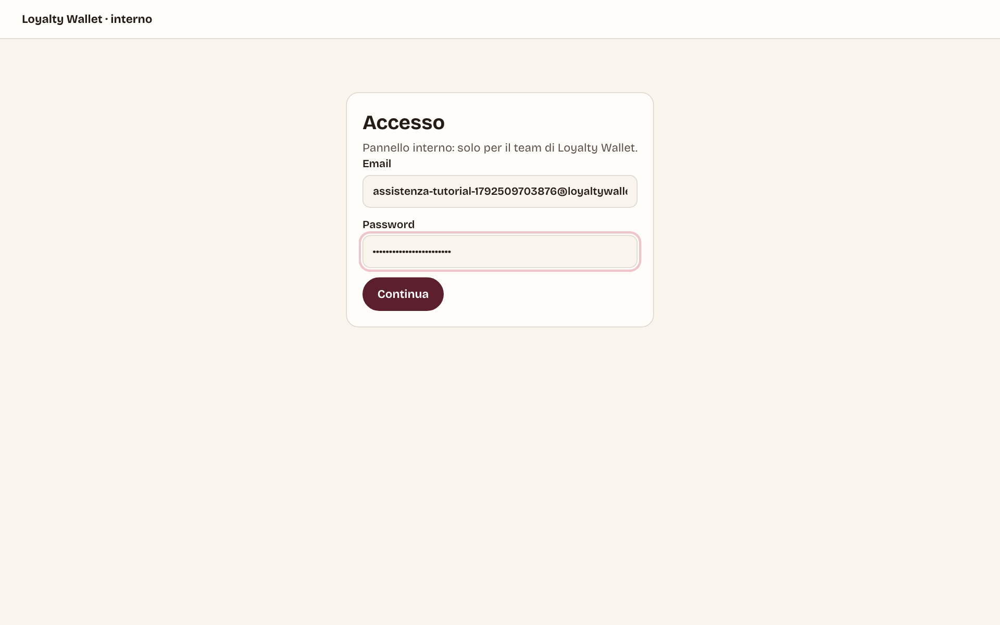

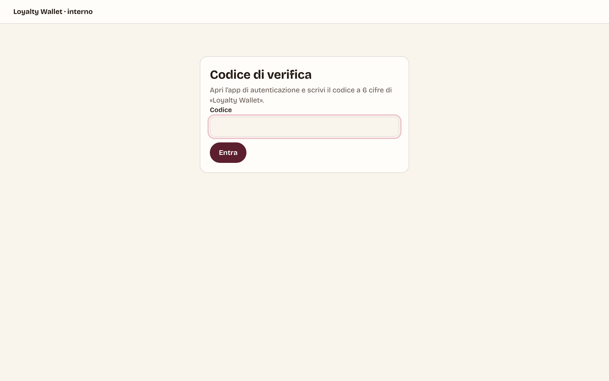

### 7.1 Assistenza: una ricerca sola

Si incolla quello che dice l'esercente: codice assistenza `ERR-…`, ticket `DIAG-…`, codice errore, codice della
carta, telefono, email dello staff o nome del negozio.

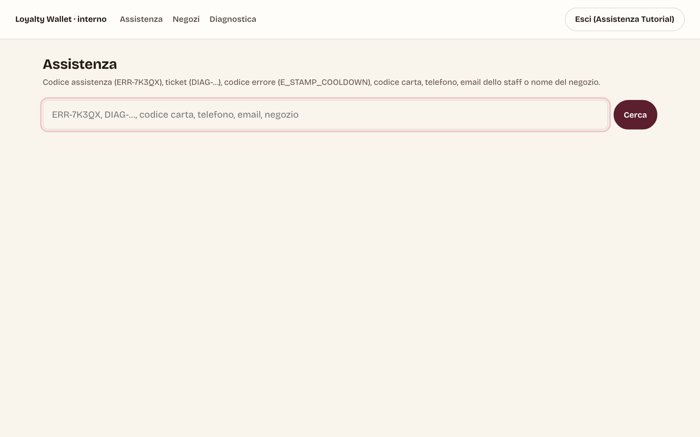

Un codice errore porta la spiegazione dal catalogo (causa probabile e cosa fare) e le richieste recenti con quel
codice:

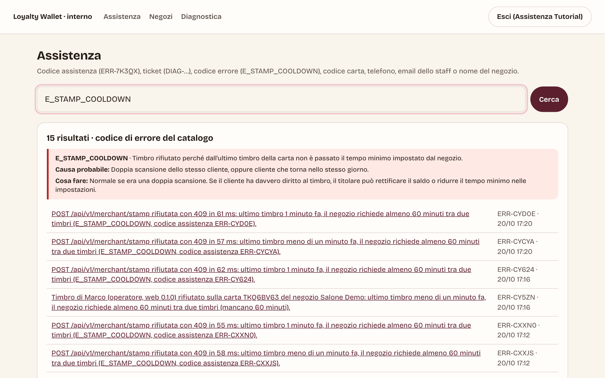

Il codice di una carta apre la scheda del cliente: saldo nel database confrontato con la carta su Google
(**Risincronizza** se non coincidono), richieste GDPR (esportazione, cancellazione), modalità diagnostica e la
timeline di tutto quello che è successo alla carta.

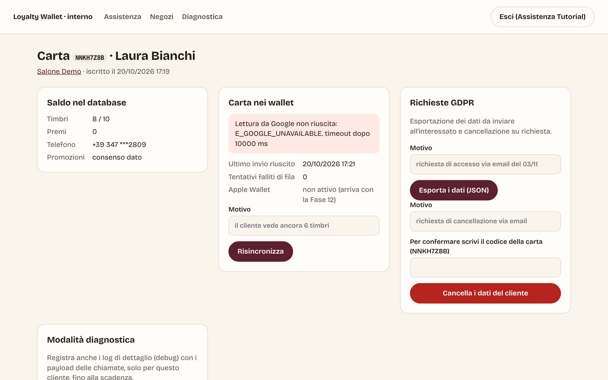

Più in basso la timeline: richieste dell'app, timbri, correzioni e iscrizione, ognuna con il suo codice assistenza.

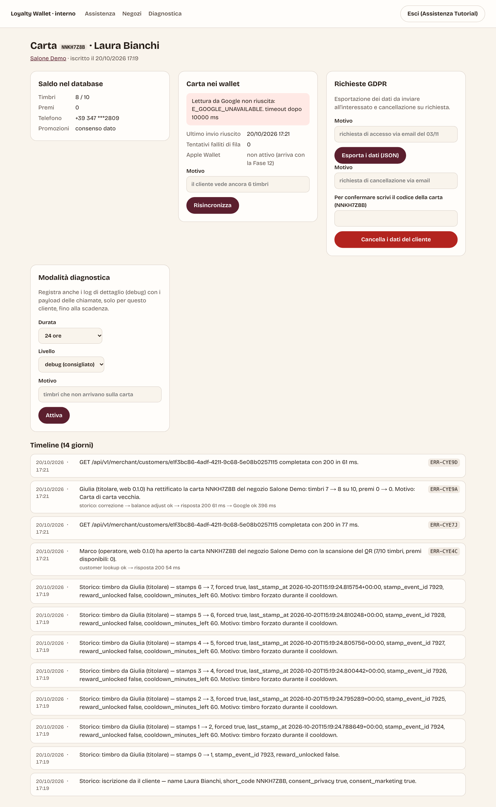

### 7.2 Negozi

Elenco con stato, clienti e staff; scheda del negozio; creazione di un nuovo negozio con l'invito al titolare.

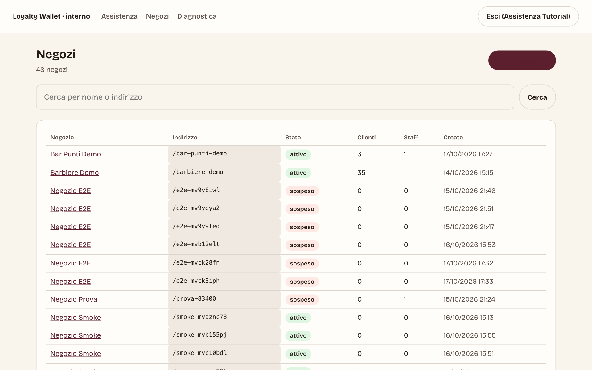

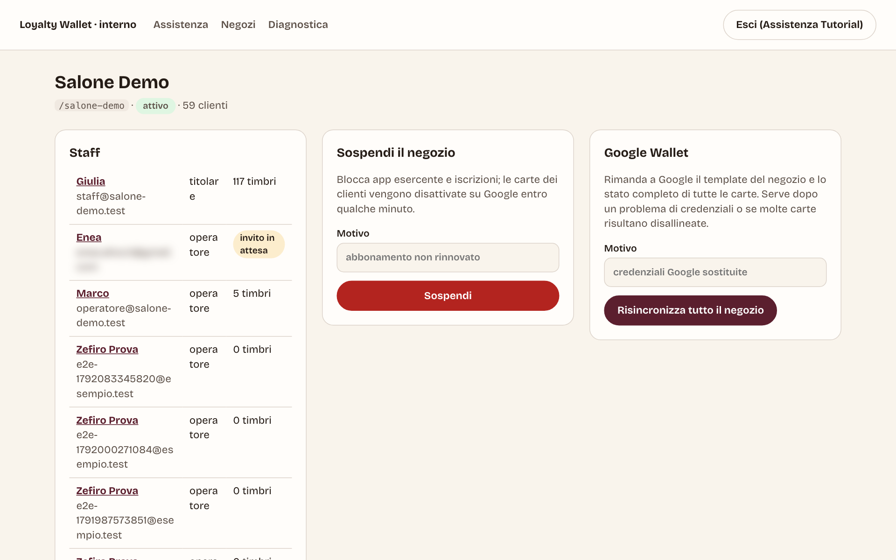

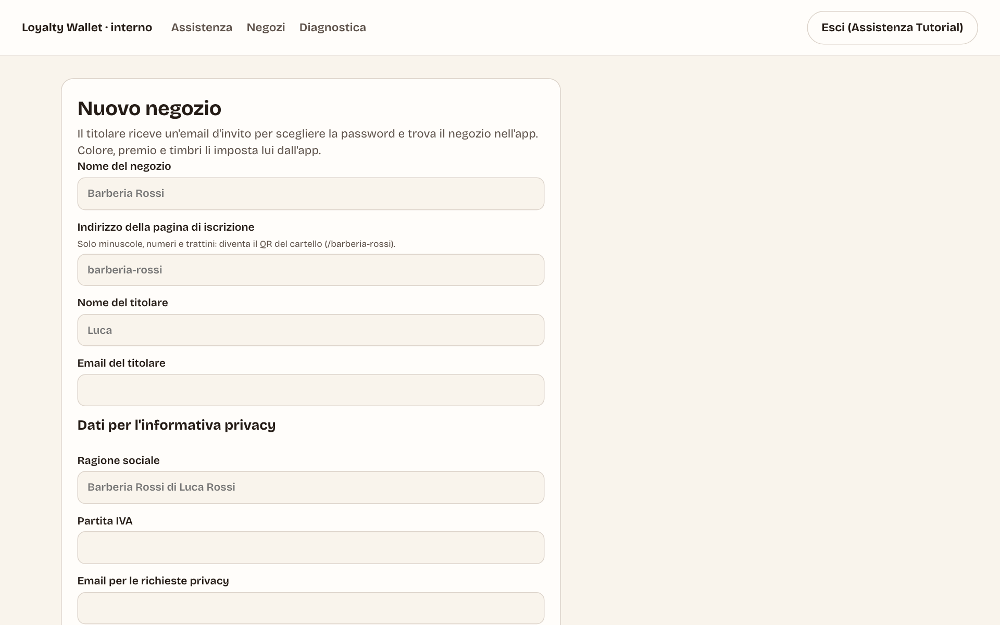

### 7.3 Diagnostica

Le modalità diagnostiche attive e i pacchetti "Invia diagnostica" ricevuti dalle app; ogni pacchetto mostra il
dispositivo e gli eventi dell'app, con la spiegazione degli errori.

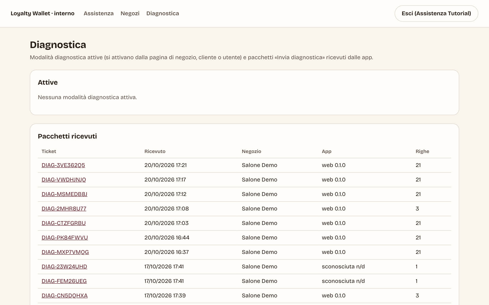

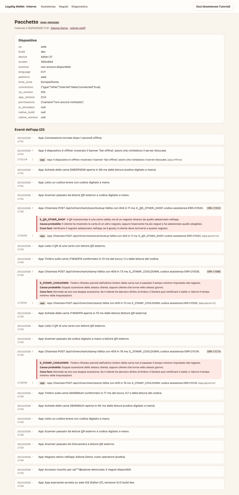

---

## Come rigenerare gli screenshot

Servono Supabase locale, il web su `:3000` e l'app esercente su `:8081`. Il web va avviato con il **codice SMS di
prova**, altrimenti lo script si ferma (con Twilio vero partirebbero SMS a numeri inventati):

```bash
OTP_PROVIDER=test OTP_LIMIT_PER_IP_HOUR=100000 APP_BASE_URL=http://localhost:3000 pnpm --filter @loyalty/web dev
```

```bash
pnpm --filter @loyalty/merchant dev
```

```bash
TUTORIAL_OTP_TEST=1 node apps/merchant/scripts/tutorial-screenshots.mjs
```

Un argomento facoltativo esegue solo una sezione (`cliente`, `accesso`, `cassa`, `fotocamera`, `titolare`, `tessere`,
`punti`, `interno`). Lo script crea i propri clienti e tessere di esempio con le funzioni Postgres e li cancella al
giro successivo; per il pannello interno crea un membro del team con 2FA e lo elimina alla fine. Le immagini finiscono
in `docs/tutorial/img/`; gli errori della console delle pagine in `apps/merchant/e2e-logs/tutorial-console.log`.
